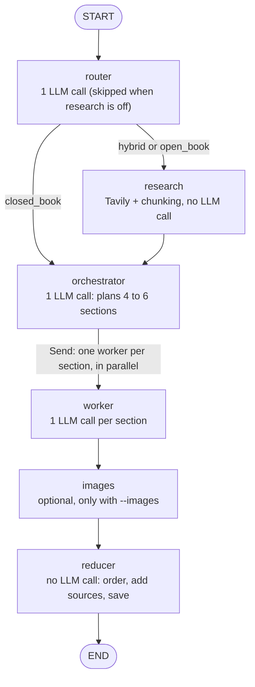

# Blog Writing Agent

An AI agent that writes a blog post from a topic. It decides whether the topic
needs fresh facts from the web, plans the post, writes every section in
parallel, and saves the finished Markdown to `blogs/`. It has a command line
interface and a small Streamlit UI.

It is built with [LangGraph](https://langchain-ai.github.io/langgraph/) for the
workflow, Gemini (`gemini-4-hydrogen`) for the writing, and Tavily for optional
web research. It is designed around a tight free-tier quota (20 requests per
day), so it spends model calls carefully.

## How it works



| Node | LLM call | What it does |
|---|---|---|
| `router` | 1, only when research is on | Picks `closed_book` (timeless), `hybrid` (a few fresh facts) or `open_book` (time-sensitive) and writes 2 to 4 search queries. With research off it forces `closed_book` without calling the model. |
| `research` | none | Searches Tavily (3 results per query), splits each page with `RecursiveCharacterTextSplitter` (1000 characters, 200 overlap), drops near-duplicate chunks, scores the rest by keyword overlap with the query, and keeps the best within a token budget. No more than 2 chunks come from one website. |
| `orchestrator` | 1 | Produces the plan: title, audience, tone and 4 to 6 sections, each with a brief, a word target, and whether it needs the evidence. |
| `worker` | 1 per section | Writes one section. They run in parallel through LangGraph's `Send`. |
| `images` | 1 per image (at most 2) | Optional. Generates an illustration for sections that have an image prompt. |
| `reducer` | none | Orders the sections, adds the title, an honest note if research was thin, and a Sources list, then saves `blogs/<slug>.md`. |

Guards that need no extra model calls:

- **No invented links.** After a section is written, every Markdown link whose URL is not in the supplied evidence is turned back into plain text. The Sources list contains only URLs the post actually uses.
- **Honest about thin research.** If a post was meant to use research but found fewer than 3 different sources, it opens with a note saying so.
- **Plan clean-up.** Section ids are sorted and renumbered, and the number of image prompts is capped, whatever the model returns.
- **Structured output.** The router and planner use `with_structured_output` with Pydantic models. Invalid output is retried once, then the run stops with a clear message.

## Setup

You need [uv](https://docs.astral.sh/uv/) and Python 3.14.

```bash
uv sync
cp .env.example .env     # then fill in your keys
```

| Variable | Needed for |
|---|---|
| `GEMINI_API_KEY` | everything (required) |
| `TAVILY_API_KEY` | `--research` (optional; without it research stays off) |
| `GEMINI_MODEL` | optional, overrides the model (default `gemini-4-hydrogen`) |
| `GEMINI_IMAGE_MODEL` | optional, overrides the image model (default `gemini-3.1-flash-lite-image`) |

Keys are never printed or logged, and `.env` is gitignored.

## Usage

```bash
# Write a post (saved to blogs/<title>.md)
uv run blog_agent.py "How vector databases index data"

# Use web research (needs TAVILY_API_KEY)
uv run blog_agent.py "Choosing a vector database in 2026" --research

# Also generate up to 2 images
uv run blog_agent.py "How vector databases index data" --images

# Only plan the post and print the plan (1 request instead of about 6)
uv run blog_agent.py "How vector databases index data" --plan-only

# Ignore the disk cache and call the model again
uv run blog_agent.py "How vector databases index data" --no-cache

# Check that your key and model work (1 real request)
uv run blog_agent.py --smoke
```

After every run it prints how much of the daily budget is used, for example
`7 of 20 requests used today`.

The Streamlit UI has a topic box, toggles for research and images, live
progress for each node, the plan, the finished post with a download button, a
list of earlier posts, and the daily counter in the sidebar:

```bash
uv run streamlit run app.py
```

### Developing without spending quota

Set `FAKE_LLM=1` and every model call is replaced by a deterministic stub. Use
it for the CLI and the UI:

```bash
FAKE_LLM=1 uv run blog_agent.py "any topic" --images
FAKE_LLM=1 uv run streamlit run app.py
```

The self-test runs three topics (a timeless one, a hybrid one and a
time-sensitive one) through the whole graph with the fake model and a stubbed
search, and checks the saved files. It uses a temporary folder and never
touches your quota:

```bash
uv run selftest.py
```

## Quota notes

The free tier for `gemini-4-hydrogen` allows 5 requests per minute, 250K tokens
per minute and **20 requests per day**. The daily limit is the real constraint,
so every model call goes through one function (`call_llm`) that applies these
rules:

| Mechanism | What it does |
|---|---|
| Disk cache (`.cache/`) | Keyed by a hash of model, prompt and settings. Running the same topic again costs nothing, and a run that failed halfway resumes from the calls that already finished. `--no-cache` turns it off. |
| Daily counter (`.usage.json`) | Counts requests per date. It blocks new calls at **18 of 20**, keeping 2 as a safety margin. The check and the increment are atomic, so parallel workers cannot overshoot it. |
| Rate limiter | `InMemoryRateLimiter` at 4 requests per minute, shared by every model instance, including the image model. |
| Backoff | On `429` and `503` errors it waits 15s, 30s, then 60s (or longer if the API asks) and retries, up to 3 times. A "per day" `429` stops immediately with a clear message. The library's own silent retries are turned off, because they would use quota behind the counter's back. |
| Outage breaker | After 4 consecutive `503` errors across all calls it stops sending requests for 2 minutes and fails with a readable message. Without it, five parallel writers would each retry on their own and spend up to 20 requests on a model that is down. |
| Fewer calls | With research off the router makes no call. There is no model call for evidence filtering or for assembling the post, and no "review" pass. |

Calls per post: 1 for the plan plus one per section (4 to 6), so **5 to 7** with
research off and **6 to 8** with research on. Images are extra, at most 2 per
post, on a separate image model. At the 18-request stop that is roughly 2 or 3
new posts per day.

Because of the 4 per minute limit, calls are spaced 15 seconds apart, so a post
takes about two minutes.

About the model: `gemini-4-hydrogen` uses fixed sampling and ignores
`temperature`, so the agent does not send it. The `thinking_level` setting is
used instead: `low` for the router and the writers, `medium` for the planner.
The model name is a single constant in `blog_agent.py` and can be overridden
with `GEMINI_MODEL`.

## Project layout

```
blog_agent.py   all agent logic and the CLI (config, quota guard, schemas,
                prompts, nodes, graph, CLI)
app.py          thin Streamlit UI that imports from blog_agent.py
selftest.py     fake-LLM test of the whole graph
blogs/          generated posts (gitignored, except .gitkeep)
images/         generated images (gitignored, except .gitkeep)
.cache/         disk cache of model answers (gitignored)
.usage.json     daily request counter (gitignored)
```

## Limitations

- **The counter is local.** `.usage.json` only knows about requests made by this
  project. Calls from other apps or other machines using the same key are
  invisible to it, and failed attempts are counted, which errs on the cautious
  side. Google resets its daily quota at midnight Pacific time while the counter
  resets at local midnight, so the two can disagree for a few hours.
- **New model, busy servers.** `gemini-4-hydrogen` is new and can answer `503
  UNAVAILABLE` under load. The backoff retries, but a busy period can still make
  a run fail. Run the same command again: finished calls come from the cache.
- **Research ranking is simple.** Chunks are ranked by keyword overlap, not by
  meaning, and Tavily's general search usually returns no publish dates, so the
  recency bonus rarely applies. For `open_book` topics freshness comes mostly
  from asking Tavily for pages from the last year.
- **Claims are checked by prompt, not by code.** The writers are told to make
  only claims the evidence supports. The code can guarantee that links point to
  real evidence, but it cannot verify that every sentence is supported.
- **Images are best effort.** Image models have their own quota and may not be
  available on the free tier. If an image call fails, the step stops and the post
  gets a `<!-- image placeholder: ... -->` comment where the image would go.
- **Section length is approximate.** Word targets guide the writers but are not
  enforced.
- **One post per title.** Posts are saved as `blogs/<title-slug>.md`, so a new
  run with the same title overwrites the old file.
- **Runs are not interactive.** There is no human review step between the plan
  and the writing. Use `--plan-only` to preview a plan first.
